# tab5-emu

Games on the [M5Stack Tab5](https://docs.m5stack.com/en/core/Tab5), an
ESP32-P4 handheld with a 5" 1280x720 display, built with
[ESPP](https://github.com/esp-cpp/espp). A launcher, a pause menu with save
states, and a `Cart` per game or emulator core, in the same shape as
[esp-box-emu](https://github.com/esp-cpp/esp-box-emu) so glue can move
between the two.

Three of the carts are not emulators. They are native ports of PC and
PlayStation games, running the games' own code as C on the two 360 MHz
RISC-V cores with a software rasterizer: Jedi Knight and Metal Gear Solid from
decompiled source, The Phantom Menace from a static recompilation of your own
copy of the game (see below).

## Metal Gear Solid, natively

https://github.com/user-attachments/assets/24d01f38-ea30-4a68-a6e2-731dbd7e1fb0

<p>
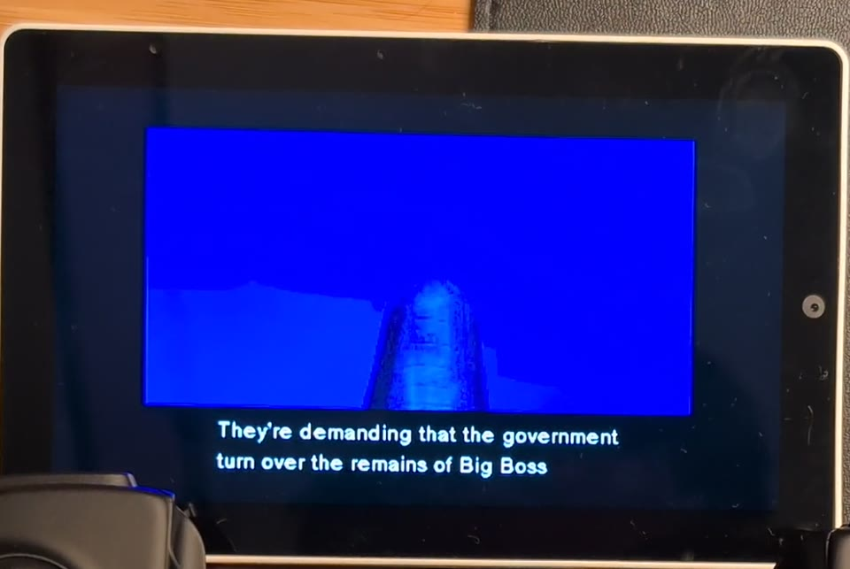 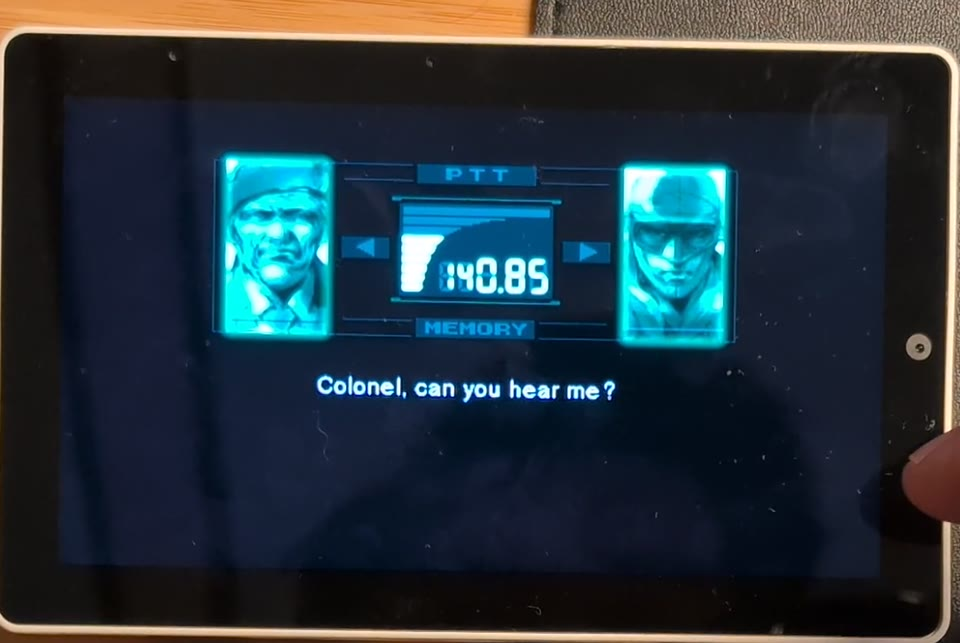 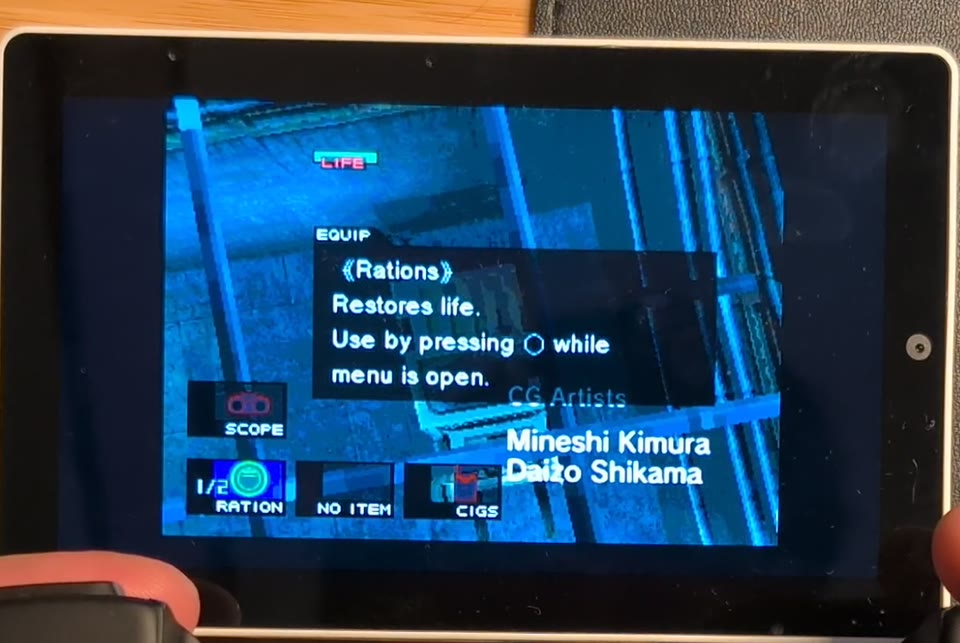
</p>

The FoxdieTeam decompilation of the PlayStation game
([mgs_reversing](https://github.com/FoxdieTeam/mgs_reversing)) compiled for
the ESP32-P4, with [psyz](https://github.com/Xeeynamo/psyz) standing in for
the PSY-Q SDK, the GPU, the GTE and the SPU. Both on `esp32p4` branches of
esp-cpp forks. It boots the retail chain from the extracted US disc on the
card: the title, the opening, the dock, the elevator, topside; cutscenes
with the frame-buffer effects, codec calls, sound effects, music and
speech. Gameplay runs at about 28 fps against the game's own 30 fps cap,
drawn by two rasterizer workers, one per core, each taking a band of rows.
Save and load states from the pause menu. See
[components/mgs/README.md](components/mgs/README.md).

## Star Wars Episode I: The Phantom Menace, recompiled

https://github.com/user-attachments/assets/a1001e13-553d-4048-aa23-dba5409316e3

<p>
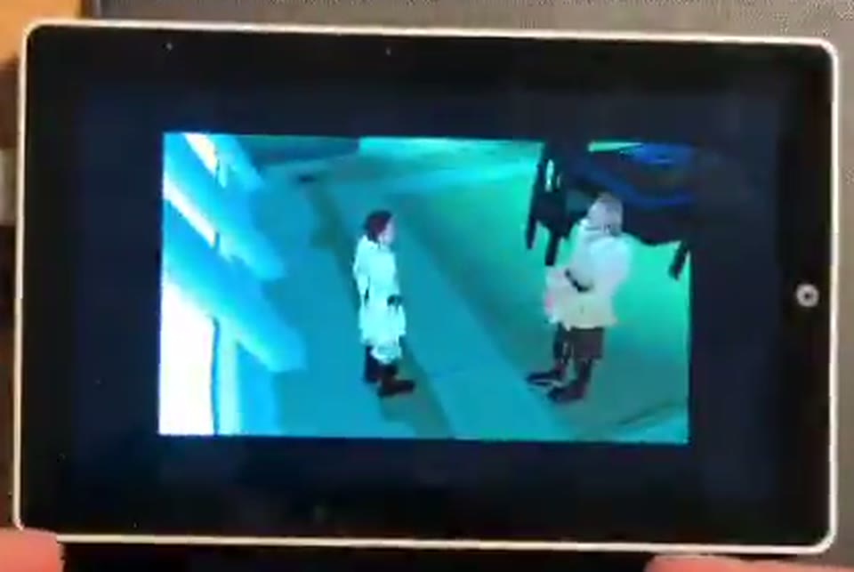 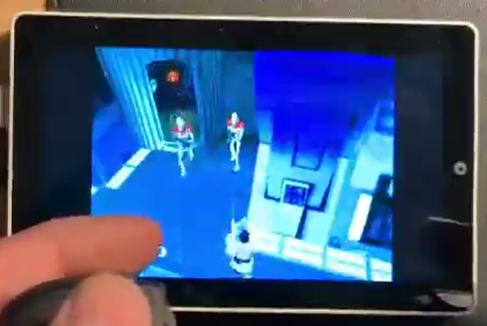 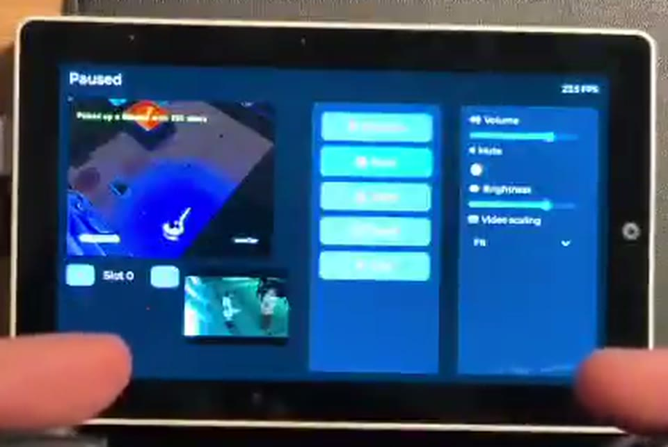
</p>

The 1999 PlayStation game, USA Rev 1, through
[tpm-decomp](https://github.com/esp-cpp/tpm-decomp): its static recompiler
turns the game's executable into C at build time, and its runtime is the
PlayStation around that C (BIOS, interrupts, DMA, CD-ROM, MDEC, GPU ports)
on the same psyz rasterizer, GTE and SPU as the Metal Gear Solid port. It
boots from the disc image on the card through the title, the full-motion
movies (MDEC video with XA audio at the movies' full 15 fps) and the levels,
at about 27 fps in game with sound effects, music and speech. Save and
load states from the pause menu.

**Recompiled, not (yet) decompiled.** Unlike the other two ports, TPM does not
run from decompiled source. `tpm-decomp/tools/recomp.py` translates every
MIPS instruction of the executable into C, mechanically. That C is
effectively Sony's executable in another form, so it is never committed or
distributed. It is generated in the build directory from **your own** copy
of the game (`CONFIG_TPM_DISC_PATH`, see Build below), so a playable TPM
needs a local build. The firmware from CI, built without the executable, carries only the
cart's load-screen viewer.

The goal is a real, matching decompilation: hand-written C that compiles back
to the byte-identical executable, as mgs_reversing is for Metal Gear Solid.
tpm-decomp has started one (the executable is split and rebuilds
byte-identical, and the first functions are in C), and decompiled functions
can replace recompiled ones one at a time. Once the decompilation is
complete, TPM would build from source like the MGS port, with only the game
data on the card. Contributions are very welcome. See
[components/tpm/README.md](components/tpm/README.md).

## Star Wars: Jedi Knight – Dark Forces II

https://github.com/user-attachments/assets/2e6b5173-f53a-4591-8347-96aa53e222f2

<p>
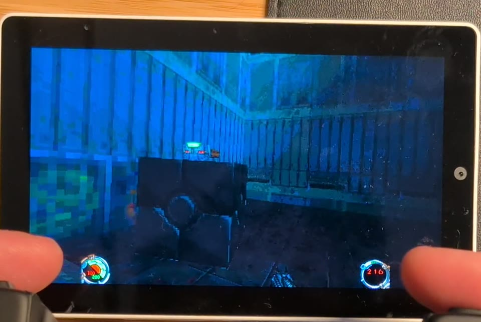 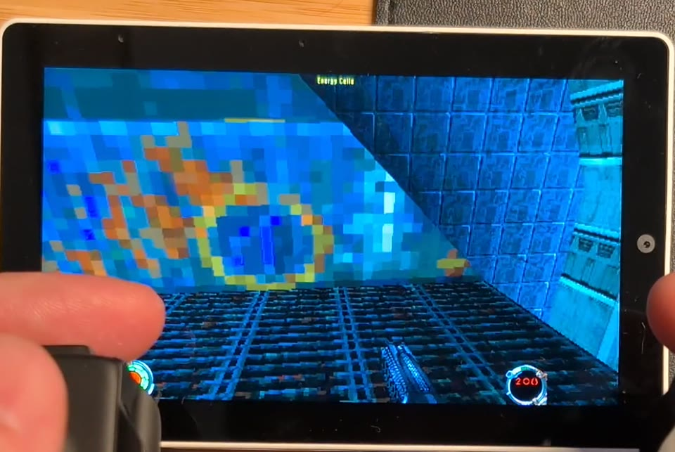 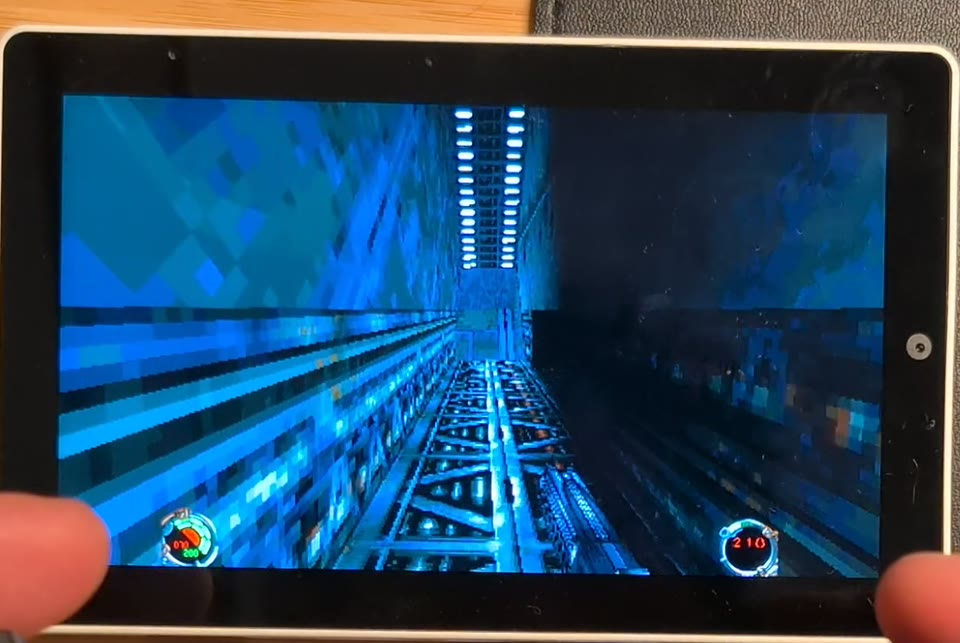
</p>

The 1997 PC game through [OpenJKDF2](https://github.com/shinyquagsire23/OpenJKDF2)
(our fork: [esp-cpp/OpenJKDF2](https://github.com/esp-cpp/OpenJKDF2),
branch `esp32p4`): the engine's software rasterizer draws the world at a
low internal resolution and the P4's 2D accelerator scales it to the panel,
with the HUD composited at full resolution. Playable on hardware with
sound, music, the full-motion cutscenes (Smacker video and audio at the
movies' full 15 fps; Start skips), saves, and a USB keyboard and mouse or a
gamepad. The port
plan and its history are in [docs/PLAN.md](docs/PLAN.md).

## Emulators

| Core | Source | Status |
|---|---|---|
| Genesis / Mega Drive | gwenesis (shared with esp-box-emu) | full speed |
| SNES | snes9x2005 | full speed |
| Game Boy Advance | gpSP | close to full speed; heavy scenes drop a few frames |

https://github.com/user-attachments/assets/641a64b0-b3af-429b-8582-a38fc9a5cdad

<p>
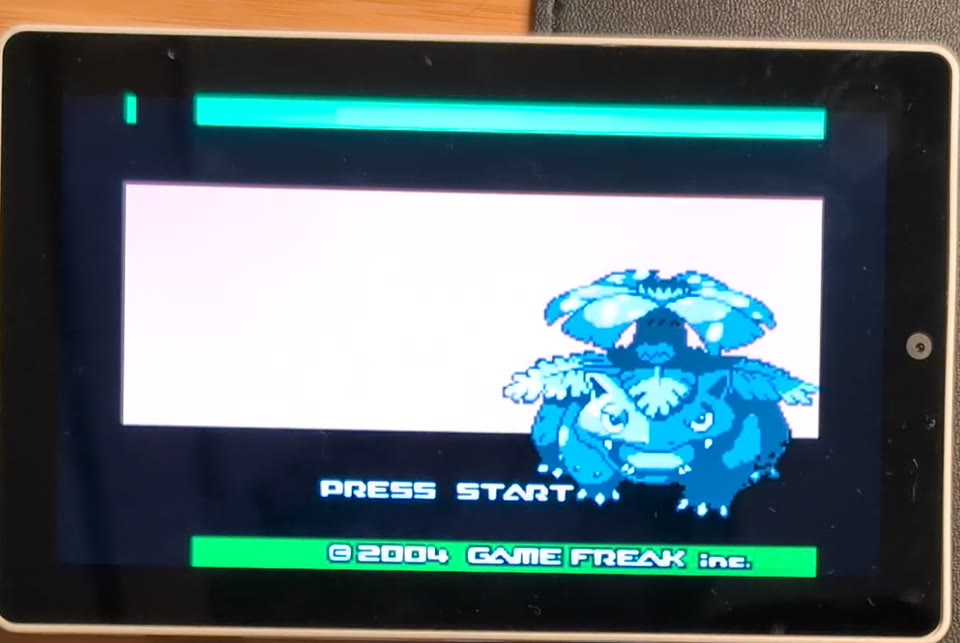 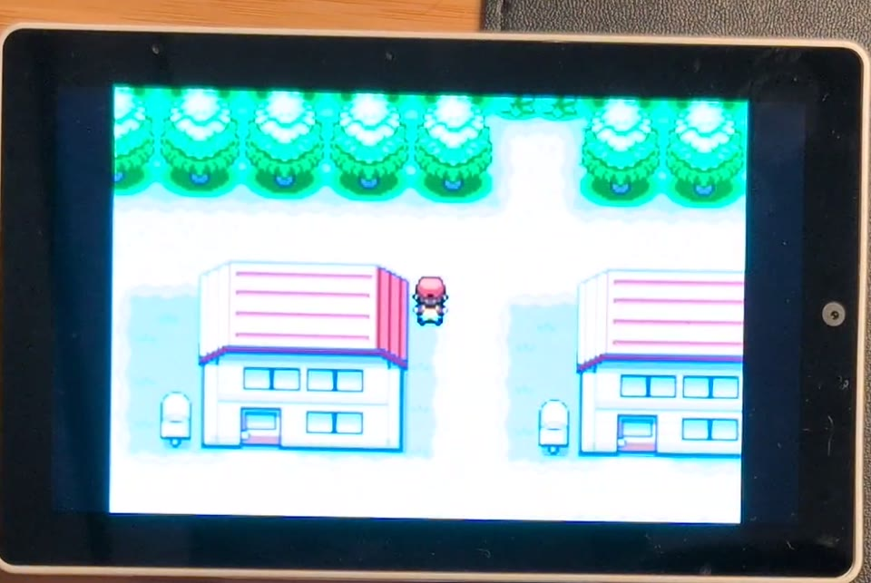
</p>

## Hardware

| | |
|---|---|
| SoC | ESP32-P4 (dual RISC-V @ 360 MHz, FPU, PPA 2D accelerator, 32 MB PSRAM) |
| Display | 5" 1280x720 MIPI-DSI (portrait-native, rotated to landscape) |
| Touch | GT911 capacitive |
| Audio | ES8388 codec + NS4150B amp, dual mics |
| Storage | microSD (SDMMC 4-bit) |
| Input | touch (virtual gamepad), BOOT button (pause menu), USB keyboard / mouse / gamepad on the USB-A port (hubs supported) |
| USB-C | serial console, or the SD card as a USB drive (settings > "USB drive") |

## Layout

```
main/               app_main, Cart base class, per-game carts
components/
  tab5-emu/         HAL (Tab5Emu): display / PPA video path, audio, SD, input
  gui/              LVGL launcher (rom list + boxart + settings)
  menu/             LVGL in-game pause menu (resume/reset/save/load/quit)
  rom_info/         metadata.csv parsing
  statistics/       frame timing
  jk/               OpenJKDF2 port: engine submodule + ESP32 platform layer + glue
  mgs/              Metal Gear Solid: mgs_reversing + psyz submodules + the Tab5 platform layer
  tpm/              The Phantom Menace: tpm-decomp submodule (static recompiler + runtime) + glue
  gba/ genesis/ snes/   the emulator cores and their glue
docs/PLAN.md        the Jedi Knight plan and history
```

## SD card layout

```
/sdcard/
  metadata.csv                # rom_path, boxart_path, name
  boxart/*.jpg                # baseline JPEG, ~400x400
  jk/                         # your Jedi Knight install (copy from CD / GOG)
    jk.cd                     # (any marker file; metadata points here)
    episode/JK1.gob JK1CTF.gob JK1MP.gob
    resource/Res1hi.gob Res2.gob jk_.cd
    resource/video/*.SMK      # optional, cutscenes
    MUSIC/Track12.wav ...     # optional, the soundtrack: run
                              # tools/convert_music.py <game dir> on the GOG / Steam
                              # MUSIC folder (IMA ADPCM; the .ogg originals also
                              # play, but Vorbis decoding costs ~75% of a core)
    player/                   # saves / settings (created)
  mgs/                        # Metal Gear Solid, extracted from your own US disc
    STAGE.DIR RADIO.DAT FACE.DAT ZMOVIE.STR VOX.DAT DEMO.DAT BRF.DAT
                              # (components/mgs/mgs_reversing/port/extract_disc.py)
  tpm/                        # The Phantom Menace, USA Rev 1: the .bin of a bin/cue rip
    Star Wars - Episode I - The Phantom Menace (USA) (Rev 1).bin
  saves/                      # save states and their screenshots
```

Example `metadata.csv` (one line per game: rom path, boxart, name; the
platform comes from the path: `.md`/`.gen` Genesis, `.sfc`/`.smc` SNES,
`.gba` Game Boy Advance, `jk.cd` Jedi Knight, `STAGE.DIR` Metal Gear Solid,
`SLUS_008.84` The Phantom Menace):

```
jk/jk.cd, boxart/jk.jpg, Star Wars: Jedi Knight - Dark Forces II
mgs/STAGE.DIR, boxart/mgs.jpg, Metal Gear Solid
tpm/SLUS_008.84, boxart/tpm.jpg, Star Wars Episode I: The Phantom Menace
genesis/sonic.md, boxart/sonic.jpg, Sonic the Hedgehog
snes/smw.sfc, boxart/smw.jpg, Super Mario World
gba/mk.gba, boxart/mk.jpg, Mario Kart: Super Circuit
```

No game data is included. A real `gba_bios.bin` next to a GBA ROM is used
when present; otherwise the open-source BIOS built into gpSP is used.

## Build

Requires ESP-IDF v6.x.

```
git clone --recurse-submodules=components/jk/OpenJKDF2 \
          --recurse-submodules=components/mgs/mgs_reversing \
          --recurse-submodules=components/mgs/psyz \
          --recurse-submodules=components/tpm/tpm-decomp \
          https://github.com/esp-cpp/tab5-emu
cd tab5-emu
idf.py set-target esp32p4
idf.py build flash monitor
```

(Do not recurse into the engine's own submodules; they are desktop-only
dependencies.)

The Phantom Menace is recompiled from your own disc at build time: set
`CONFIG_TPM_DISC_PATH` to your USA Rev 1 disc image (the `.bin` of a bin/cue
rip) in `idf.py menuconfig`, under "Star Wars Episode I: The Phantom
Menace", before building. Without it the build succeeds with a warning and
the TPM cart only shows the game's load screens. See
[components/tpm/README.md](components/tpm/README.md#building).

## Controls

Touch (virtual gamepad):

- Left third: d-pad (relative to the zone center)
- Right third: A (lower right), B (lower left), X (upper right), Y (upper left)
- Bottom strip of the middle third: SELECT (left) / START (right)
- Top-right corner, or the BOOT button: pause menu

USB keyboard / mouse / gamepad on the USB-A port (directly or through a
hub; the host runs at full speed so hubs work). Devices are decoded from
their HID report descriptors (espp `hid-rp` report map), so any standard HID
gamepad works: face buttons by position (A = east, B = south, X = north,
Y = west), shoulders and triggers = L / R (the triggers are also reported on
their own as L2 / R2), select / start (also the Consumer "back" / "menu"
controls of mobile pads), d-pad / hat / left stick = d-pad, select+start or
the home button = pause menu. Known layouts: Xbox-style and DirectInput /
DualShock numbering, Backbone Pro quirks. Keyboards: arrows, Z/X/A/S, Enter,
Shift/Backspace, Q/W (L/R) and E/R (L2/R2) map to the gamepad for the
emulators.

Jedi Knight gets the full keyboard and mouse look; on a gamepad the left
stick strafes, the right stick looks, R = fire, L = secondary fire, A =
activate, B = jump, X = crouch, Y = use item.

Metal Gear Solid uses the PlayStation layout by position: face buttons as
Cross / Circle / Square / Triangle, L1 / R1 on the shoulders, L2 / R2 on the
triggers for the item and weapon menus, so a pad with triggers (or the
keyboard's E / R) is needed for those.

New controllers: the console prints each device's decoded buttons on change
(debug level in `usb_hid.cpp`); a wrong mapping is a quirk-table entry in
espp's `hid-rp-report-map.hpp`.

## Crashes

Core dumps go to flash (`coredump` partition) and are printed base64 on the
console at the next boot, so a crash while the console is unavailable (the
USB drive hand-over) can still be read. Decode with:

```
base64 -d < dump.b64 > core.bin
python -m esp_coredump --chip esp32p4 info_corefile -t raw -c core.bin build/tab5-emu.elf
```

Note that a terminal which opens the console port with DTR low and RTS high
resets the chip (`rst:0x17 CHIP_USB_UART_RESET`); keep both asserted, or
expect a reboot whenever the console re-enumerates (after the USB drive).

## USB drive (file transfer)

Settings > "USB drive" exposes the SD card as a USB mass storage device on
the USB-C port, so ROMs, boxart and game data can be copied without pulling
the card. While the drive is on the serial console is off (the Tab5's
USB-C carries the P4's full-speed USB PHY, which the console and the USB
device controller share) and the launcher cannot start games; switch it off
(eject first) to get the card, the console and the ROM list back.

## License

MIT (this project). OpenJKDF2, mgs_reversing and psyz are under their own
licenses; the game data is not included and must come from your own copies
of the games.
